# 작업 등록 매뉴얼

{{cover_kicker}}

{{cover_lead}}

**읽는 분:** {{audience}}  
**말투:** {{voice}}  
**작성일:** 2026-10-23

---

## 목차

1. 전체 순서 — 작업 관리 → 작업 상세 → 프로파일 · 품질 조회
2. 작업 관리 화면 — 조회 · 새 작업 · 상세 · 프로파일 · 품질 버튼
3. 새 작업 만들기 — 공사 · 호기 · 품목 · 이음부 · 첫 패스 · 만들기
4. 목록에서 상세 · 프로파일 · 품질 열기 — 행마다 바로가기
5. 작업 상세 — 기본 정보 — 공사 · 품목 · 이음부 · 작업자 · 시간 · 규격 · 저장 · 지우기
6. 작업 상세 — 패스 — 패스 목록 확인 · 패스 추가 진입
7. 작업 상세 — 패스 추가 창 — 패스 번호 · 시작 · 끝 · 종류 · 추가
8. 작업 상세 — 첨부 — 에셋 올리기 · 에셋 붙이기 · 패스 지정
9. 첨부 — 에셋 올리기 창 — 파일 · 작업 · 패스 · 장비 · 시간 0 · 올리기
10. 파일 종류 — 시간 자료 — 영상 · 음성 · 센서 · 시간 0 필수 · 빠른 채우기
11. 파일 종류 — 문서 · 이미지 — pdf · jpg · png · 시간 0 선택
12. 프로파일 화면 — 작업 요약 · 패스 선택 · 전류 · 전압 파형
13. 품질 화면 — 패스 선택 · 성적서 · 문서 · 파형

---

## 1. 전체 순서

왼쪽 메뉴 **[작업 관리]**에서 시작해, 아래 순서로 진행합니다.

1. **작업 관리** — 새 작업을 만들거나 기존 작업을 고릅니다.
2. **작업 상세** — 기본 정보 · 패스 · 첨부를 확인하고 정리합니다.
3. **조회 화면** — 프로파일 · 품질로 같은 작업을 살펴봅니다.

한 줄로 말하면: **작업을 먼저 잡고 → 패스와 자료를 정리한 뒤 → 같은 작업으로 조회합니다.**

---

## 2. 작업 관리 화면

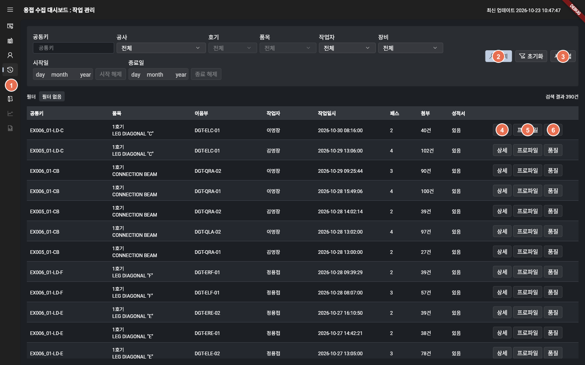

| 번호 | 무엇을 하나요 |
|:---:|---|
| ① | 왼쪽 **[작업 관리]** 메뉴 |
| ② | **[조회]** — 목록 불러오기 |
| ③ | **[새 작업]** — 새로 등록 |
| ④ | **[상세]** — 작업 내용 열기 |
| ⑤ | **[프로파일]** — 파형 보기 |
| ⑥ | **[품질]** — 품질 결과 보기 |

---

## 3. 새 작업 만들기

**[새 작업]**을 누르면 창이 열립니다. 작업과 패스를 한 번에 넣고 **[만들기]**를 누릅니다.

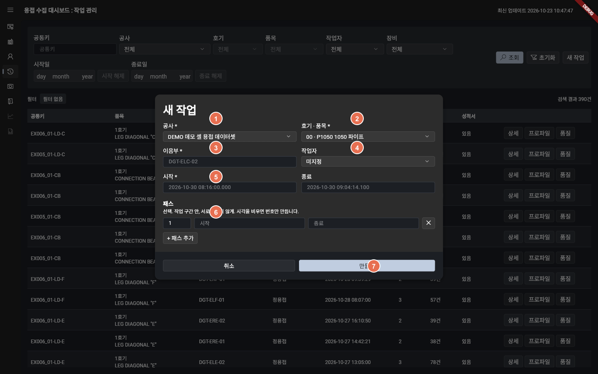

| 번호 | 항목 | 비고 |
|:---:|---|---|
| ① | 공사 | 필수 |
| ② | 호기 · 품목 | 필수 |
| ③ | 이음부 | 필수 |
| ④ | 작업자 | 선택 |
| ⑤ | 시작 · 종료 시각 | 시작은 필수 |
| ⑥ | 패스 구간 | 선택 |
| ⑦ | **[만들기]** | 저장 |

만들면 목록이 그 작업에 맞춰지고 행이 선택됩니다. 이어서 **[상세]**로 들어가면 됩니다.

---

## 4. 목록에서 상세 · 프로파일 · 품질 열기

새 작업을 만든 뒤에도, 예전에 있던 작업을 열 때도 같은 버튼을 씁니다.

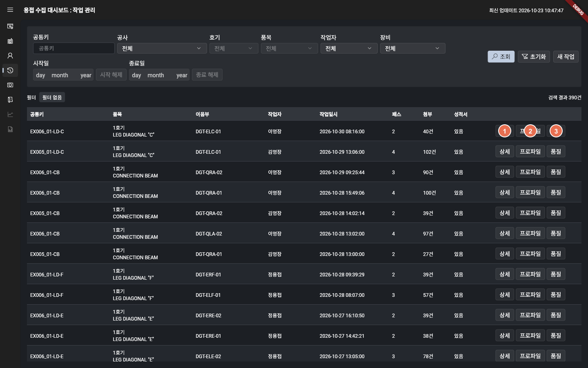

| 번호 | 버튼 | 하는 일 |
|:---:|---|---|
| ① | **[상세]** | 기본 정보 · 패스 · 첨부를 고치고 정리합니다 |
| ② | **[프로파일]** | 패스별 전류 · 전압 등 파형을 봅니다 |
| ③ | **[품질]** | 품질 결과와 파형을 함께 봅니다 |

---

## 5. 작업 상세 — 기본 정보

공사 · 품목 · 이음부 · 작업자 · 작업 시간 · 규격을 확인하고 고칩니다. 끝나면 **[저장]**을 누릅니다.

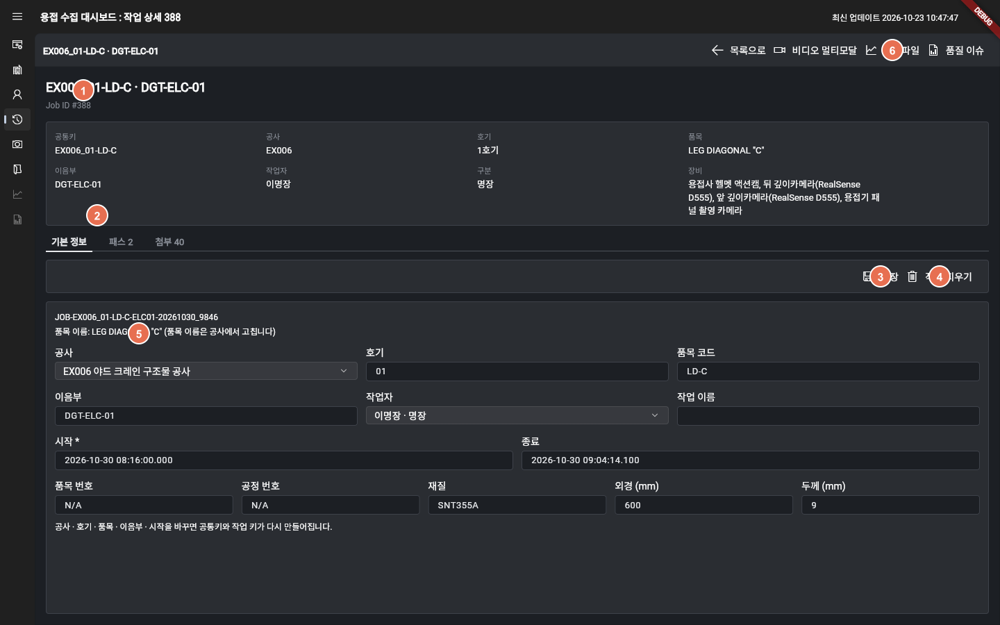

| 번호 | 항목 |
|:---:|---|
| ① | 작업 요약 카드 |
| ② | **[기본 정보]** 탭 |
| ③ | **[저장]** |
| ④ | **[작업 지우기]** (되돌릴 수 없음) |
| ⑤ | 공사 · 품목 · 시간 등 입력 칸 |
| ⑥ | 프로파일 · 품질로 바로 이동 |

작업 시간을 줄일 때 패스가 밖으로 나가면 저장되지 않습니다.

---

## 6. 작업 상세 — 패스

패스는 조회할 때 나누는 **시간 단위**입니다. 시작 · 끝과 종류를 맞춰 둡니다.

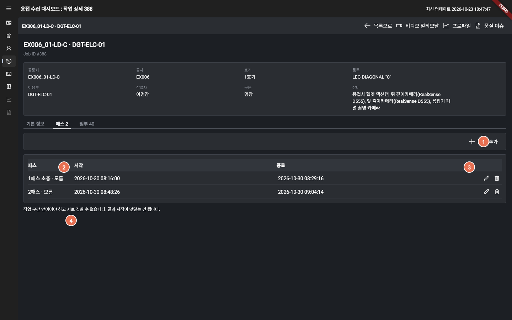

| 번호 | 항목 |
|:---:|---|
| ① | **[+ 패스 추가]** |
| ② | 패스 목록 (시작 · 종료) |
| ③ | 수정 · 지우기 아이콘 |
| ④ | 구간 규칙 안내 (겹침 불가) |

패스는 작업 시간 안이어야 하고, 서로 겹치면 안 됩니다. 지우면 그 패스에 붙은 자료는 작업 공용이 됩니다.

---

## 7. 작업 상세 — 패스 추가 창

패스 탭에서 **[+ 패스 추가]**를 누르면 이 창이 열립니다.

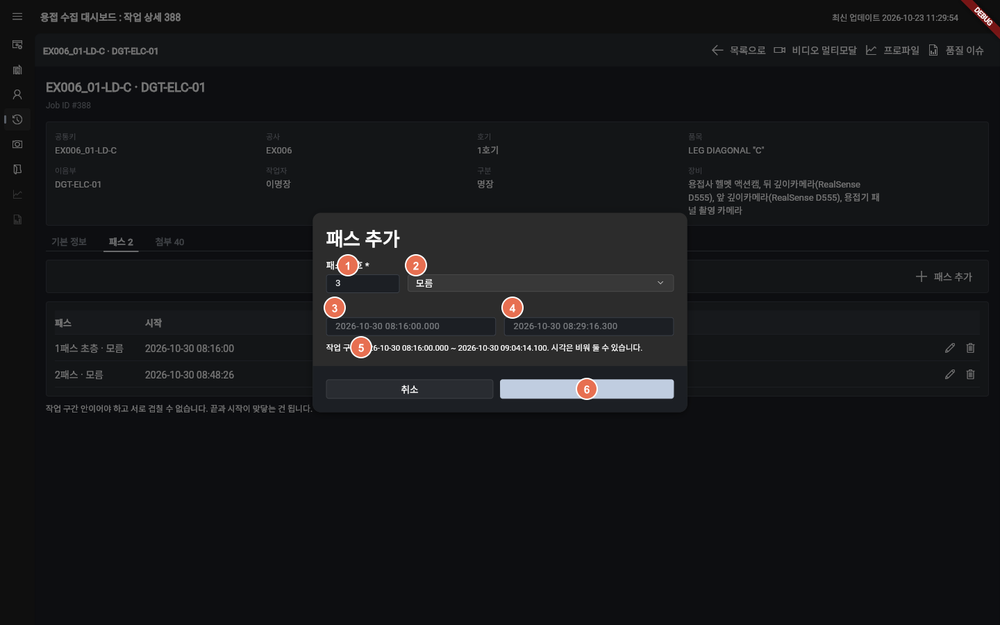

| 번호 | 항목 | 안내 |
|:---:|---|---|
| ① | 패스 번호 * | 중복되면 안 됩니다 |
| ② | 종류 | 초층 · 채움 · 캡 등 |
| ③ | 시작 시각 | 비워 둘 수 있습니다 |
| ④ | 종료 시각 | 비워 둘 수 있습니다 |
| ⑤ | 작업 구간 안내 | 이 구간 안이어야 합니다 |
| ⑥ | **[추가]** | 저장 |

---

## 8. 작업 상세 — 첨부

영상 · 센서 등 자료를 올리고, 이미 있는 자료를 붙이며, 어느 패스에 속할지 정합니다.

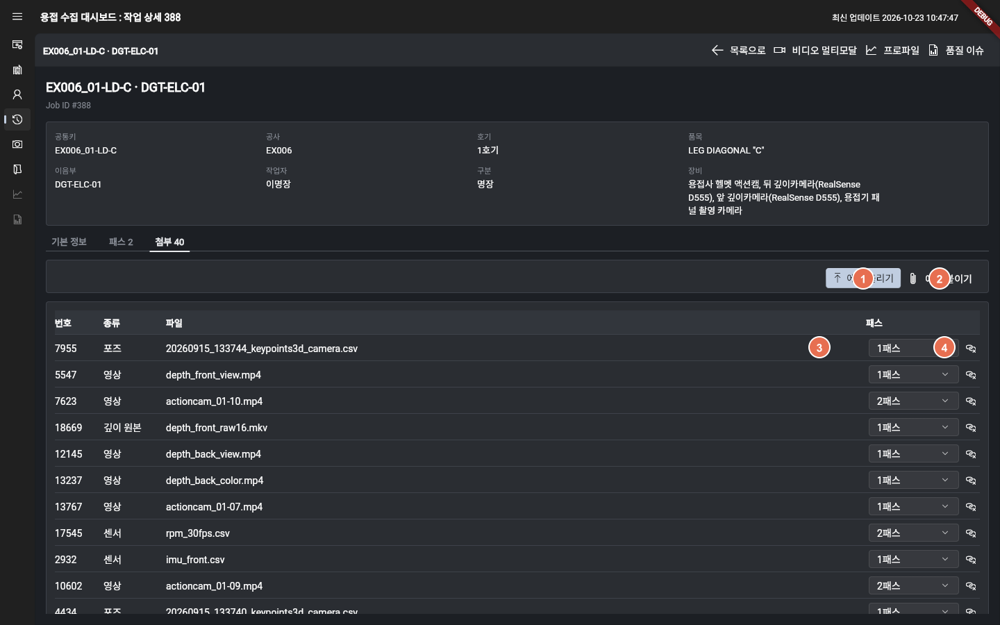

| 번호 | 항목 |
|:---:|---|
| ① | **[에셋 올리기]** — 새 파일 올리기 |
| ② | **[에셋 붙이기]** — 기존 자료 연결 |
| ③ | 패스 칸 — 어느 패스에 속할지 |
| ④ | 연결 끊기 — 작업과의 연결만 끊김 (파일은 남음) |

---

## 9. 첨부 — 에셋 올리기 창

첨부 탭에서 **[에셋 올리기]**를 누르면 열립니다. 파일을 고르면 안내가 바뀌며, 다음 장에서 종류별로 봅니다.

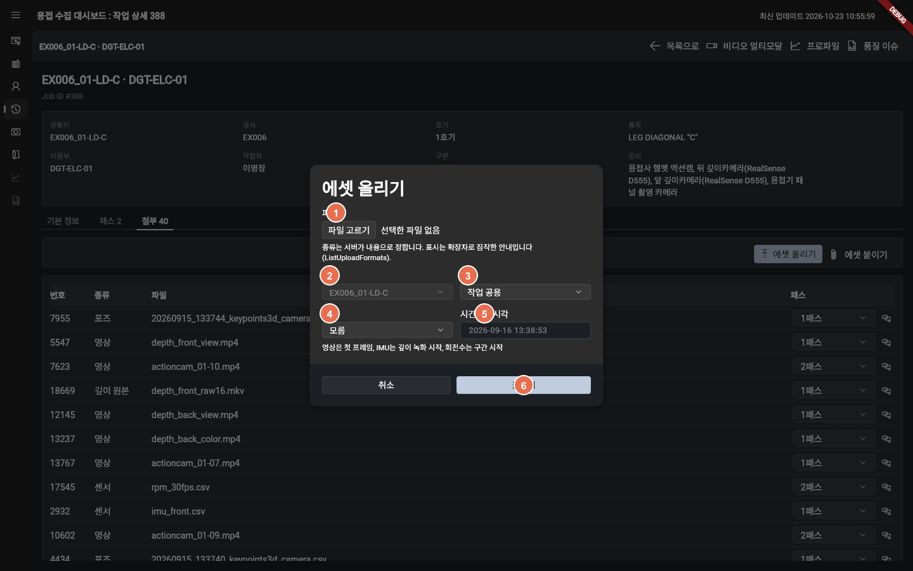

| 번호 | 항목 |
|:---:|---|
| ① | 파일 고르기 — 고르면 종류 · 후처리 안내가 뜸 |
| ② | 작업 — 이 작업으로 고정 |
| ③ | 패스 — 또는 작업 공용 |
| ④ | 장비 (선택) |
| ⑤ | 시간 0의 시각 — 시간 자료면 필수 * |
| ⑥ | **[올리기]** |

확장자는 화면 안내용입니다. **최종 종류는 서버가 파일 내용으로 정합니다.**

---

## 10. 파일 종류 — 시간 자료

mp4 · mkv · wav · csv 등을 고르면 아래처럼 안내와 필수 칸이 바뀝니다.

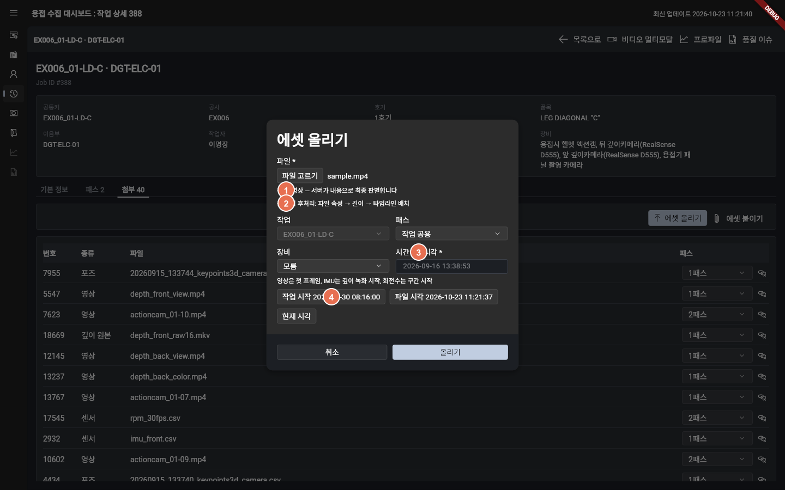

| 번호 | 항목 |
|:---:|---|
| ① | 종류 안내 — 확장자로 짐작, 최종은 서버가 내용으로 판별 |
| ② | 올린 뒤 후처리 — 예: 속성 → 길이 → 타임라인 배치 |
| ③ | 시간 0의 시각 * — 시간 자료는 필수. 없으면 올릴 수 없음 |
| ④ | 빠른 채우기 — 작업 시작 · 파일 시각 · 현재 시각 |

> 시간 0이 필요한 종류: 영상(mp4·mkv·mov), 깊이 원본(mkv), 음성(wav·mp3·m4a), 패널·IMU·회전수·신호·포즈(xlsx·csv).  
> 시간 0 안내: 영상 = 첫 프레임, IMU = 깊이 녹화 시작, 회전수 = 구간 시작.  
> 센서·포즈 종류는 사람이 고르지 않습니다. 서버가 CSV·엑셀 머리행으로 정합니다.

---

## 11. 파일 종류 — 문서 · 이미지

pdf · jpg · png를 고르면 시간 0 시각이 필수가 아닙니다. 후처리 안내도 종류에 맞게 바뀝니다.

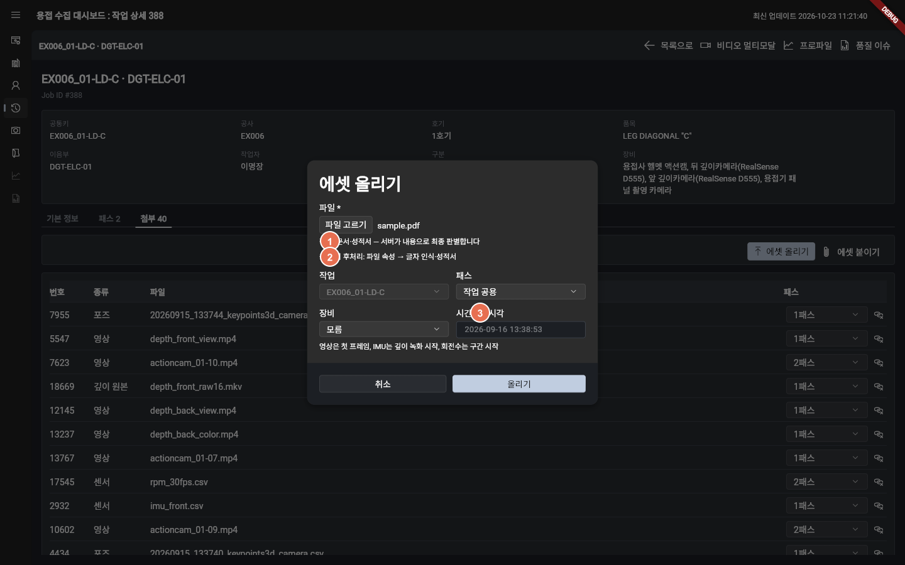

| 번호 | 항목 |
|:---:|---|
| ① | 종류 짐작 — pdf → 문서 · 성적서, jpg · png → 이미지 |
| ② | 올린 뒤 후처리 — pdf: 속성 → 글자 인식 · 성적서 / 이미지: 속성만 |
| ③ | 시간 0의 시각 — 필수 표시(*) 없음. 비워도 올릴 수 있음 |

성적서인지는 올리는 사람이 고르지 않습니다. 글자 인식 결과로 정해집니다.

표에 없는 형식은 **등록만** 되고 후처리는 없습니다.

---

## 12. 프로파일 화면

목록의 **[프로파일]** 또는 작업 상세의 **[프로파일]**로 엽니다. 패스마다 전류 · 전압 등 파형을 봅니다.

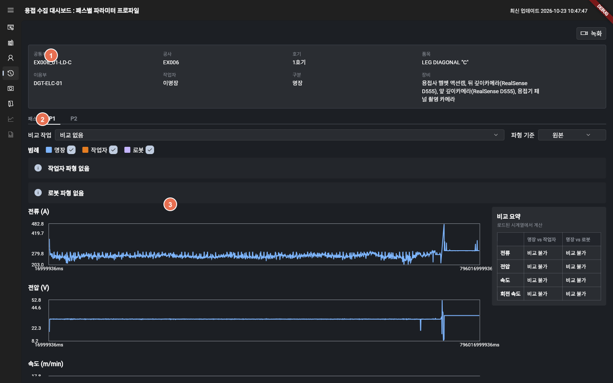

| 번호 | 항목 |
|:---:|---|
| ① | 작업 요약 카드 — 공사 · 품목 · 작업자 · 장비를 한눈에 봅니다 |
| ② | 패스 선택 — P1, P2…를 바꿔 패스별 파형을 봅니다 |
| ③ | 파형 차트 — 전류 · 전압 · 속도 등을 시간 흐름으로 봅니다 |

---

## 13. 품질 화면

목록의 **[품질]** 또는 작업 상세의 **[품질 이슈]**로 엽니다. 성적서와 파형을 같은 패스 기준으로 함께 봅니다.

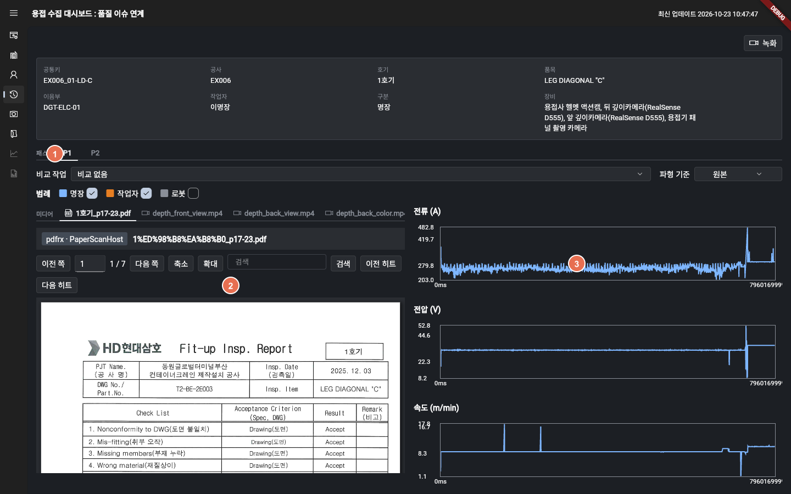

| 번호 | 항목 |
|:---:|---|
| ① | 패스 선택 — P1, P2…를 바꿔 패스별 결과를 봅니다 |
| ② | 성적서 · 문서 — PDF · 영상 등 품질 자료를 봅니다 |
| ③ | 파형 — 같은 패스의 전류 · 전압 등을 봅니다 |

---

## 끝으로

등록이 끝나면 아래만 다시 확인해 주세요.

1. 작업 관리에서 작업과 패스를 만들었는가  
2. 상세에서 기본 정보가 맞는가  
3. 패스 구간 · 종류가 조회에 쓸 수 있는가  
4. 첨부에서 자료 올리기 · 붙이기 · 패스 지정이 끝났는가  
5. 프로파일 · 품질에서 같은 작업을 열 수 있는가  

문의는 용접 수집 대시보드 운영 담당에게 남겨 주세요.
