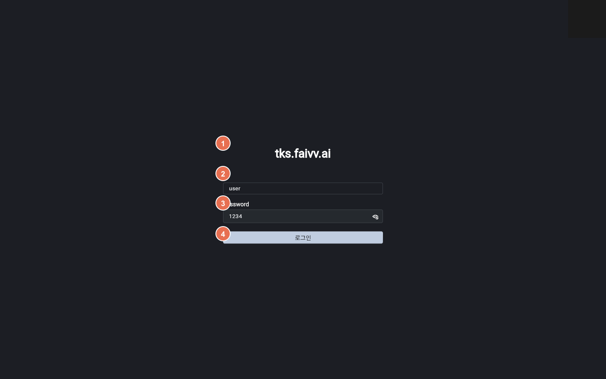
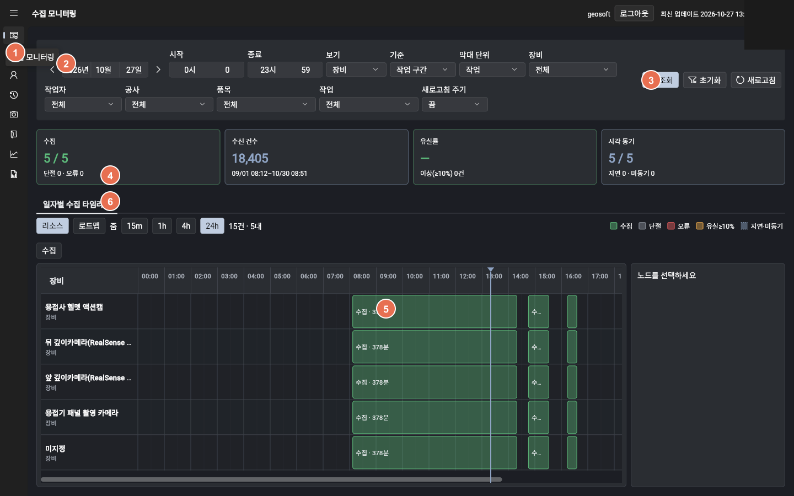

# 작업 등록 매뉴얼

{{cover_kicker}}

{{cover_lead}}

**읽는 분:** {{audience}}  
**말투:** {{voice}}  
**작성일:** 2026-10-27

---

## 개요

- **용접 수집 대시보드** — 수집 모니터링에서 조회·타임라인으로 현황을 보고, 작업 등록·첨부로 자료를 정리한 뒤 프로파일·품질로 같은 작업을 확인하는 현장 안내
- **읽는 분** — 용접 현장 관리자
- **하는 일** — 로그인 · 수집 모니터링 · 작업 등록 · 첨부 · 프로파일·품질
- **순서** — 로그인 → 수집 모니터링 → 작업 관리 → 프로파일·품질
- **계정** — ID `user` · 비밀번호 `1234`. 게스트(`user`)는 조회 일부 불가

---

## 목차

1. 로그인 — ID · 비밀번호 · 게스트(제한) 계정
2. 수집 모니터링 — 조회·검색 · 일자별 수집 타임라인
3. 작업 관리 화면 — 조회 · 새 작업 · 상세 · 프로파일 · 품질 버튼
4. 새 작업 만들기 — 공사 · 호기 · 품목 · 이음부 · 첫 패스 · 만들기
5. 목록에서 상세 · 프로파일 · 품질 열기 — 행마다 바로가기
6. 작업 상세 — 기본 정보 — 공사 · 품목 · 이음부 · 작업자 · 시간 · 규격 · 저장 · 지우기
7. 작업 상세 — 패스 — 패스 목록 확인 · 패스 추가 진입
8. 작업 상세 — 패스 추가 창 — 패스 번호 · 종류 · 시작 · 끝 · 추가
9. 작업 상세 — 첨부 — 에셋 올리기 · 에셋 붙이기 · 패스 지정
10. 첨부 — 에셋 올리기 창 — 다건 대기열 · 주제 · 상황 · 작업 · 패스 · 장비 · 시간 0 · 올리기
11. 파일 종류 — 시간 자료 — 영상 · 음성 · 센서 · 파일별 시간 0 · 빠른 채우기 · 상태
12. 파일 종류 — 문서 · 이미지 — pdf · jpg · png · 시간 0 선택 · 상태
13. 프로파일 화면 — 작업 요약 · 패스 선택 · 전류 · 전압 파형
14. 품질 화면 — 패스 선택 · 성적서 · 문서 · 파형

---

## 1. 로그인

앱을 열면 로그인 화면이 나옵니다. ID와 비밀번호를 넣고 **[로그인]**을 누릅니다.

- **ID:** `user`
- **Password:** `1234`

| 번호 | 항목 |
|:---:|---|
| ① | 앱 이름 |
| ② | ID — `user` |
| ③ | Password — `1234` |
| ④ | **[로그인]** |

| 계정 | 안내 |
|---|---|
| geosoft | 일반 — 안내된 화면을 이어서 사용 (비밀번호 `1234`) |
| user | 게스트(제한) — 조회 일부 불가 (비밀번호 `1234`) |

로그인에 성공하면 **수집 모니터링** 화면으로 들어갑니다.

---

## 2. 수집 모니터링

로그인 직후, 또는 왼쪽 메뉴 **[수집 모니터링]**으로 엽니다. 일자·조건으로 **조회·검색**한 뒤 **일자별 수집 타임라인**에서 하루 수집을 확인합니다.

| 번호 | 항목 |
|:---:|---|
| ① | 왼쪽 **[수집 모니터링]** 메뉴 |
| ② | 조회·검색 조건 — 일자 · 시작·종료 · 보기 · 장비 · 작업 · 새로고침 주기 등 |
| ③ | **[조회]** · **[초기화]** · **[새로고침]** |
| ④ | **일자별 수집 타임라인** 탭 |
| ⑤ | 타임라인 영역 — 시간축과 수집 막대 |
| ⑥ | 보기 전환 — 리소스 · 로드맵 |

조건을 고른 뒤 **[조회]**를 누르면 타임라인이 맞춰집니다.  
작업 등록·첨부는 왼쪽 **[작업 관리]**로 이어집니다.

---

## 3. 작업 관리 화면

| 번호 | 무엇을 하나요 |
|:---:|---|
| ① | 왼쪽 **[작업 관리]** 메뉴 |
| ② | **[조회]** — 목록 불러오기 |
| ③ | **[새 작업]** — 새로 등록 |
| ④ | **[상세]** — 작업 내용 열기 |
| ⑤ | **[프로파일]** — 파형 보기 |
| ⑥ | **[품질]** — 품질 결과 보기 |

---

## 4. 새 작업 만들기

**[새 작업]**을 누르면 창이 열립니다. 작업과 패스를 한 번에 넣고 **[만들기]**를 누릅니다.

| 번호 | 항목 | 비고 |
|:---:|---|---|
| ① | 공사 | 필수 |
| ② | 호기 · 품목 | 필수 |
| ③ | 이음부 | 필수 |
| ④ | 작업자 | 선택 |
| ⑤ | 시작 · 종료 시각 | 시작은 필수 |
| ⑥ | 패스 구간 | 선택 |
| ⑦ | **[만들기]** | 저장 |

만들면 목록이 그 작업에 맞춰지고 행이 선택됩니다. 이어서 **[상세]**로 들어가면 됩니다.

---

## 5. 목록에서 상세 · 프로파일 · 품질 열기

새 작업을 만든 뒤에도, 예전에 있던 작업을 열 때도 같은 버튼을 씁니다.

| 번호 | 버튼 | 하는 일 |
|:---:|---|---|
| ① | **[상세]** | 기본 정보 · 패스 · 첨부를 고치고 정리합니다 |
| ② | **[프로파일]** | 패스별 전류 · 전압 등 파형을 봅니다 |
| ③ | **[품질]** | 품질 결과와 파형을 함께 봅니다 |

---

## 6. 작업 상세 — 기본 정보

공사 · 품목 · 이음부 · 작업자 · 작업 시간 · 규격을 확인하고 고칩니다. 끝나면 **[저장]**을 누릅니다.

| 번호 | 항목 |
|:---:|---|
| ① | 작업 요약 카드 |
| ② | **[기본 정보]** 탭 |
| ③ | **[저장]** |
| ④ | **[작업 지우기]** (되돌릴 수 없음) |
| ⑤ | 공사 · 품목 · 시간 등 입력 칸 |
| ⑥ | **[프로파일]** · **[품질 이슈]** 로 바로 이동 |

작업 시간을 줄일 때 패스가 밖으로 나가면 저장되지 않습니다.

---

## 7. 작업 상세 — 패스

패스는 조회할 때 나누는 **시간 단위**입니다. 시작 · 끝과 종류를 맞춰 둡니다.

| 번호 | 항목 |
|:---:|---|
| ① | **[+ 패스 추가]** |
| ② | 패스 목록 (시작 · 종료) |
| ③ | 수정 · 지우기 아이콘 |

패스는 작업 시간 안이어야 하고, 서로 겹치면 안 됩니다. 지우면 그 패스에 붙은 자료는 작업 공용이 됩니다.

---

## 8. 작업 상세 — 패스 추가 창

패스 탭에서 **[+ 패스 추가]**를 누르면 이 창이 열립니다.

| 번호 | 항목 | 안내 |
|:---:|---|---|
| ① | **패스 번호 *** | 중복되면 안 됩니다 |
| ② | **종류** | 초층 · 채움 · 캡 등 |
| ③ | **시작** | 비워 둘 수 있습니다 |
| ④ | **종료** | 비워 둘 수 있습니다 |
| ⑤ | **[추가]** | 저장 |

---

## 9. 작업 상세 — 첨부

영상 · 센서 등 자료를 올리고, 이미 있는 자료를 붙이며, 어느 패스에 속할지 정합니다.

| 번호 | 항목 |
|:---:|---|
| ① | **[에셋 올리기]** — 새 파일 올리기 |
| ② | **[에셋 붙이기(첨부만)]** — 기존 자료 연결 |
| ③ | 패스 칸 — 어느 패스에 속할지 |
| ④ | **[떼기]** — 작업과의 연결만 끊김 (파일은 남음) |

---

## 10. 첨부 — 에셋 올리기 창

첨부 탭에서 **[에셋 올리기]**를 누르면 열립니다. 파일을 **여러 개** 고르면 대기열에 넣고, 동시에 최대 3개까지 올립니다. 큰 파일은 이어 올리기로 보냅니다.

| 번호 | 항목 |
|:---:|---|
| ① | 주제 (선택) — 이번 올리기에 공통으로 쓰는 짧은 글 |
| ② | 상황 (선택) — 공통으로 쓰는 짧은 글 |
| ③ | 작업 — 상세·첨부에서 열면 이 작업으로 고정 |
| ④ | 패스 — 특정 패스 또는 작업 공용 |
| ⑤ | 장비 (선택) |
| ⑥ | 시간 0의 시각(공통) — 아래 버튼으로 채운 뒤 모든 파일에 적용 가능 |
| ⑦ | **[파일 고르기]** — 여러 개 선택 → 대기열 |
| ⑧ | 파일마다 — 이름 · 종류 안내 · 후처리 · 시간 0 |
| ⑨ | **[올리기]** |

주제 · 상황은 비워도 됩니다. 나중에 에셋 상세에서 고칠 수 있습니다.  
파일 이름 옆 안내는 참고용이며, **최종 종류는 서버가 파일 내용으로 정합니다.**

---

## 11. 파일 종류 — 시간 자료

mp4 · mkv · wav · csv 등을 고르면 파일 줄의 종류·처리 안내가 바뀝니다. 위쪽 공통 칸은 §10과 같습니다.

| 번호 | 항목 |
|:---:|---|
| ① | 종류 안내 — 확장자로 짐작, 최종은 서버가 내용으로 정함 |
| ② | 올린 뒤 처리 — 예: 파일 속성 → 길이 → 타임라인 배치 |
| ③ | 이 파일의 시간 0 — 별표(*)가 있으면 필수, 없으면 선택 |
| ④ | 빠른 채우기 — 공통 시각 · 작업/패스 시작 · 현재 시각 |
| ⑤ | 진행 상태 — 올리는 중 · 처리 중 · 완료. 노란 글씨는 주의 안내 |

액션캠·깊이 영상은 촬영 시각이 없을 수 있어 시간 0을 넣는 것이 좋습니다.  
노란 주의가 나오면 첨부는 되지만 타임라인에 안 놓일 수 있습니다.

---

## 12. 파일 종류 — 문서 · 이미지

pdf · jpg · png는 시간 0이 필수가 아닙니다. 처리 안내만 종류에 맞게 바뀝니다.

| 번호 | 항목 |
|:---:|---|
| ① | 종류 — pdf는 문서·성적서, jpg·png는 이미지로 안내 |
| ② | 올린 뒤 처리 — pdf는 글자 인식·성적서, 이미지는 속성만 |
| ③ | 이 파일의 시간 0 — 선택, 비워도 됨 |

성적서인지는 올리는 사람이 고르지 않습니다. 글자 인식 결과로 정해집니다.  
표에 없는 형식은 등록만 되고 추가 처리는 없습니다.

---

## 13. 프로파일 화면

목록의 **[프로파일]** 또는 작업 상세의 **[프로파일]**로 엽니다. 패스마다 전류 · 전압 등 파형을 봅니다.

| 번호 | 항목 |
|:---:|---|
| ① | 작업 요약 카드 — 공사 · 품목 · 작업자 · 장비를 한눈에 봅니다 |
| ② | 패스 선택 — P1, P2…를 바꿔 패스별 파형을 봅니다 |
| ③ | 파형 차트 — 전류 · 전압 · 속도 등을 시간 흐름으로 봅니다 |

---

## 14. 품질 화면

목록의 **[품질]** 또는 작업 상세의 **[품질 이슈]**로 엽니다. 성적서와 파형을 같은 패스 기준으로 함께 봅니다.

| 번호 | 항목 |
|:---:|---|
| ① | 패스 선택 — P1, P2…를 바꿔 패스별 결과를 봅니다 |
| ② | 성적서 · 문서 — PDF · 영상 등 품질 자료를 봅니다 |
| ③ | 파형 — 같은 패스의 전류 · 전압 등을 봅니다 |

---

## 끝으로

등록이 끝나면 아래만 다시 확인해 주세요.

1. 로그인 후 수집 모니터링에서 조회·타임라인을 확인했는가  
2. 작업 관리에서 작업과 패스를 만들었는가  
3. 상세에서 기본 정보가 맞는가  
4. 패스 구간 · 종류가 조회에 쓸 수 있는가  
5. 첨부에서 자료 올리기(다건·상태·경고 확인) · 붙이기 · 패스 지정이 끝났는가  
6. 프로파일 · 품질에서 같은 작업을 열 수 있는가

문의는 용접 수집 대시보드 운영 담당에게 남겨 주세요.
